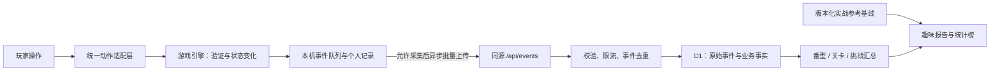

# 叠雀：行为埋点与趣味报告设计

更新：2026 年 10 月 22 日。本文保留原目标方案。**基础链路已实现；当前适配起手构筑 v6（`opening_build_v6 / four_core_v6`），保留 v5～v2 和 legacy 独立统计，由主玩法会话统一试玩、构建和发布；现实对照仍延期。** v6 初始核心＋升降笔占2槽，每关2墨共享一次编辑，准备与组牌两区非杠牌可改，满14未结算也可普通修复；prepare阶段5次弃换及每关一次补缺沿用，补缺编辑同耗共用2墨。state/action/context/terminal全部复用v5，不新增字段或数据库表；统计只读实际总分，不重算底分十倍或大番档位。V5历史分组P0回归为94/94（adapter22、server29、client/runtime/report43），不作为V6结果；本轮总数待各组完成后统一记录，不表示V6已完成浏览器验收或上线。新版以 [字段契约](FREE_PLAY_ANALYTICS_CONTRACT.md) 与 [玩法接入说明](FREE_PLAY_ANALYTICS_INTEGRATION.md) 为准，尤其合法和牌/诈胡与过关独立、新版共同分母、三类分数分列和版本隔离；下文旧路线、3+2、国标仅7种对子与只按成型过关等表述仅保留设计历史，不作为新版实现依据。已实现范围及当前限制见 [采集实现说明](ANALYTICS_IMPLEMENTATION.md)。

目标：观察玩家如何组牌、选择奇物、达成番型和完成挑战；用可追溯的真实数据生成番型统计榜、分数纪录与趣味报告。优先回答“哪些番型在本游戏里最常做成”“哪些构筑能打出高分”，并在口径明确时加入现实实战参考。

## 1. 产品交付

| 页面 | 用户看到的内容 | 用途 |
| --- | --- | --- |
| 番型图鉴与统计 | 各番型次数、成型占比、计分命中占比、含该番型的达标率、最高分、现实参考 | 判断常见番型，寻找构筑方向 |
| 我的雀行报告 | 本次挑战与累计记录、常用番型、奇物搭配、秘卷首次达成、压线过关 | 让行为数据变成有趣的回顾 |
| 纪录册 | 最高单次组牌、最高整关、最高整次挑战；纪录关联牌型、奇物、关卡及版本 | 能解释、能回看高分来源 |
| 运营分析页 | 进入游戏→开局→首次组牌→完整成型→过关→登顶的漏斗，难点、失败操作和设备表现 | 调整交互、难度与引导 |
| 开发验收面板 | 操作时间线、事件内容、待发送/已接收状态、校验失败原因 | 演示完整采集链路，验证真实上线能力 |

公开报告只展示汇总；个人报告默认来自本机记录。查看全站原始行为必须经过服务端权限校验。

## 2. 先统一统计对象与口径

- **访问会话 session**：一次连续访问；连续 30 分钟无有效交互后再操作，开始新会话。这是拟定口径，可配置。
- **挑战 run**：从确认新开局到登顶、完整成型未达标、主动结束或被新挑战明确替代；跨刷新继续沿用同一 ID。
- **关卡尝试 round attempt**：进入某一关开始组牌，至该关明确结束；同一挑战当前每关一次。不能只用“第 3 关”当唯一 ID。
- **组牌 commit**：一次被引擎接受的提交。当前普通路线一次提交 3+2 张；后续可能采用独立面子/雀头或完整手牌摸换方案，均尚未定稿，事件不硬编码第几次完成。
- **完整成型 hand**：引擎确认完成整手；包括最终未达到关卡目标的整手。未成型的中途退出不算完整成型。
- **过关 pass**：完整成型并且本关累计分达到目标。提前达到目标、尚未完成牌型时不算过关。
- **计分番型 credited pattern**：实际出现在本次结算中的番型。
- **形状匹配 structural pattern**：完整牌面满足某一统计条件，即使被高番覆盖、不另计分也可记录。它有单独的判定版本，不改变游戏计分。
- **秘卷加赏 unlock bonus**：持有对应奇物后额外触发的奖励。与基础番型分开，不把国标连七对、一色三节高写成“必须解锁”。

“当前浏览器标识”不等于自然人。未登录时不跨浏览器、跨设备拼接身份；全站样本数标为“匿名客户端数”，不冒称精确人数。

### 2.1 现有实现需要特别处理

1. `game.bestHand` 是最大单次 `commit()` 得分，不是整手或整关最高分。
2. `retire()` 同样设置 `phase='defeat'`，必须额外保留主动结束原因。
3. `patterns()` 返回已过滤的计分标签：国标连七对直接覆盖七对、清一色等；日麻役满覆盖普通役。不能拿这个列表当所有形状的出现次数。
4. 牌型按玩家提交的拆分判定，不枚举重拆最高番；现实对照必须记录这一差异。
5. `render()` 会在选牌、音效切换、美术加载后反复执行；它不是新的页面访问或奇物曝光。
6. `preview()`、`hints()`、`specialStatus()` 是试算，不能在其中上报已得分或已触发秘卷。
7. `seed` 不是唯一挑战 ID；存档 `version=1` 也不是玩法、计分或发布版本。

## 3. 番型统计榜：本次新增的核心需求

### 3.1 推荐表格

默认先选择**国标 / 日麻**，再按统计周期、玩法版本、关卡、路线、是否持有某奇物筛选。默认展示当前版本；不同计分版本的分数不混排。

| 番型 | 成型次数 | 成型占比 | 计分命中次数 / 占比 | 含此番型的达标率 | 最高整关分 | 实战参考占比 | 频率对照 |
| --- | --- | --- | --- | --- | --- | --- | --- |
| 清一色等已实现番型 | 真实统计 | 真实统计 | 真实统计 | 真实统计 | 可展开纪录详情 | 有核验来源才显示 | 可比时显示 |
| 尚未实现的番型 | 尚未实现 | — | — | — | — | 可单独展示知识资料 | 不计算 |
| 当前模式或路线不适用 | 不适用 | — | — | — | — | 可单独展示知识资料 | 不计算 |
| 已支持但尚无成型记录 | 0 | 0 / 有效分母 | 0 / 有效分母 | — | 暂无纪录 | 有来源才显示 | 不称不可能 |

表中不预填演示数据。每个比例同时显示 `分子 / 分母`；没有分母时显示“暂无样本”，不是 0%。

### 3.2 公式

以同一筛选范围、完整观测的**完整成型**集合 H 为母集，去重键为 `hand_id`。同一形状榜固定 `detector_version`；每手对同一父级番型最多计一次。每项再确定有效分母：

- H_structural(y)：H 中该版本、模式、路线支持判定 y，且 `structural_evaluation_status=success`、覆盖目录包含 y 的手。
- H_credited(y)：H 中计分结果完整、且该版本、模式、路线支持计入 y 的手。
- 判定状态为 `not_run / error`、尚未支持或不适用时不算未命中；缺少判定能力显示“未统计”。每行显示自身分母与判定覆盖率，不能把空标签数组自动解释为 0 次。

```text
成型次数(y) = COUNT DISTINCT hand_id ∈ H_structural(y)，且 structural_patterns 包含 y
成型占比(y) = 成型次数(y) / |H_structural(y)|

计分命中次数(y) = COUNT DISTINCT hand_id ∈ H_credited(y)，且 credited_patterns 包含 y
计分命中占比(y) = 计分命中次数(y) / |H_credited(y)|

含此番型的达标率(y) = 成型且过关的手数(y) / 成型次数(y)
含此番型的最高整关分(y) = MAX(round_score)，限定 structural_patterns 包含 y
```

计分视图也可计算达标率和最高分，但分子分母都必须切换为 credited，界面标明所用视图，不能一边用成型、一边用计分。

- 一手可能有多个番型，因此各行占比之和可以超过 100%。
- 日麻役牌按“白 / 發 / 中”保留子项；父级“役牌”按手去重，不能将同手两种箭牌算成两手。当前未实现风牌役，不能直接与含门风、场风的总役牌统计相比。
- 连七对在“形状视图”可同时匹配七对、清一色；在“计分视图”仍遵循当前游戏覆盖规则。
- 当前国标七对只支持七种不同对子，与允许四张同牌作两对的口径不同。日麻二盃口与七对按已提交路线/拆分记录，不隐式重拆。
- `structural_patterns` 需要新增只读统计判定器及测试。上线前可先提供明确命名的“计分出现次数 / 计分出现率”；不得悄悄用它填充成型列。
- 保存最终 14 张的 `final_tile_counts[34]`、提交面子和雀头，便于对历史数据按新统计判定器重算。重算写入新 `detector_version`，不篡改原始计分事实。

### 3.3 “最常见”与“最容易做成”

第一版将榜单命名为**最常计入得分的番型**；独立形状判定上线后再提供“最常做成的番型”。出现率还受到玩家偏好、奇物、关卡资源、开局保障和目标选择影响，不能单凭它推断内在难度。

如果要回答“主动追这个番型，究竟容不容易成功”，后续 P2 增加可跳过的“本关构筑目标”：

1. 玩家在首次有效组牌之前选择目标番型；首次提交时记录 `target_locked`，未选择记 null。
2. 之后改变目标另记 `target_changed`，不重写最初分母，避免只留下快成功的目标。
3. **目标成型率** = 初始目标为 y 且最后成型匹配 y 的已明确结束关数 / 初始目标为 y 的已明确结束关数。
4. 主动结束、被新局替代均作为独立结局列出；未观察到结束的关卡单列待定，不补成失败。报告同时给出待定占比和采集完整度。
5. 这是“主动选择该目标的玩家样本”，仍存在选择偏差。个人目标尝试较少时只报次数；全站对照分版本、模式、关卡、路线和奇物条件。
6. 仅在目标判定器覆盖完整时计算该指标；明确结束但无法判定目标的关卡标为未知，另报未知占比，不当作失败。

### 3.4 最高分与“高分番型”

纪录册同时保留三个指标：`max_commit_score`、`max_round_score`、`max_run_score`。番型详情默认显示**包含该番型的最高整关得分**，不是“这个番型独自贡献的分数”。

每条纪录关联：`run_id / round_attempt_id / hand_id / commit_id`、模式与版本、目标分、最终牌型、所有计分番型、秘卷触发、持有奇物、实际计分拆解、时间。最高整关和最大单次组牌可能不是同一关，分别保留证据。

同时提供中位数、P90 和样本量，避免只看一个极端高分；样本不足 20 手暂不展示 P90。国标和日麻原始分不直接比较；即使使用得分/目标比，也只作为条件化描述，不宣称难度等价。

## 4. 与现实实战番型频率对照

### 4.1 默认比较“完整和牌中该番型被计入的比例”

“现实胡率”至少可能指：个人每局和牌率、所有和牌中某番型的占比、所有起手中做成该番型的比例、随机抽 14 张的理论概率。它们不能相互替代。

推荐对照列名称：**日麻实战参考：和牌中的计分出现率**。若参考来自线上平台，就明确写平台与样本，不能包装成全体现实玩家或线下麻将的普遍概率。

```text
参考占比 = 参考样本中计入番型 y 的和牌次数 / 参考样本全部和牌次数
差值（百分点） = 100 × (游戏计分命中占比 - 参考占比)
相对频率 = 游戏计分命中占比 / 参考占比
```

只在定义、分母和番型映射可以对齐时计算。当前游戏完整成型集合允许国标不足八番、日麻无役，与竞技麻将的合法和牌集合不同；现阶段默认 `context_only`，仅并列展示，不计算差值或倍数。后续须额外定义并验证符合参考和牌资格的游戏子集，明确其排除数量和分母，才能使用上式；不能仅改列名就声称对齐。

参考值为 0、缺失或仅有四舍五入的“0.00%”时不显示无限倍；没有原始分子分母则不做稀有率的精细倍数比较。结构视图不能直接与“实际计分标签”参考相除。

游戏是单人肉鸽构筑，有换牌、改牌、奇物与开局保障；即使分母对齐，对照也仅描述两种环境的出现频率差异，不能解释成运气提升或难度下降的因果结论。

### 4.2 已找到的来源与接入状态

| 体系 | 候选主源 | 当前核验结果 | 接入规则 |
| --- | --- | --- | --- |
| 日麻 | [天凤官方 2026 年 4 月役统计](https://tenhou.net/sc/2026/04/prof.html) | 官方页面有桌级、东/南场、三/四人和规则筛选，标示“和了数”，按月统计；本次静态读取未取得完整数值 | 优先选四人固定桌级、固定规则、完整月份。待取得具体计数、筛选状态及使用条件后冻结快照；三人数据不得混入 |
| 国标 | [MahjongSoft 平台番种统计候选](https://mahjongsoft.com/mcrfans.php) | 本次未能读取并核实样本、分母与统计周期 | 标记 `pending_verification`；不能以视频、转载表或理论抽牌概率代填 |
| 国标 | [Salasasa 平台说明](https://salasasa.cn/guide) | 可作为牌谱研究候选；本次静态读取未取得可复核的统计表和完整说明 | 待核验具体规则、样本时间、人类/机器人范围、数据使用条件与和牌分母；尚不作为正式基线 |
| 古役 / 地方扩展 | 与该项规则吻合的数据集 | 暂无已核验基线 | 显示“暂无同规则实战参考”，优先提供游戏内触发次数与机会数 |

本次只设计基线接入，不导入百分数、不下载完整牌谱。官方汇总统计与原始牌谱的使用条件分别核验，不推定公开可访问就可自由批量再分发；也不把某类数据的限制泛化到另一类。

### 4.3 基线数据字典

每条参考必须保存以下字段，缺少核心元数据时不能标成“已核验”：

```text
baseline_id, source_name, source_url, published_at, retrieved_at, snapshot_hash
mode, rule_description, table_level, player_count, open_hand_policy
winning_eligibility, scoring_overlap_policy, decomposition_policy
period_start, period_end, timezone, sample_population
denominator_type=winning_hands, denominator_count
pattern_id, source_pattern_id, numerator_count, reported_rate, rate_precision
mapping_version, comparability=aligned|context_only|incompatible
comparability_notes, usage_status, verification_status
```

`aligned` 只表示定义与计数口径可以对照，不表示游戏环境等价。全门清构筑与现实含副露样本、国标七对差异、固定拆分与重拆取番、风牌役缺失等必须进入说明；无法对齐的行只并列展示或留空，不算倍率。

## 5. 事件契约

### 5.1 公共信封

| 字段 | 定义 |
| --- | --- |
| `event_id`, `event_name`, `schema_version` | 每条事件的随机唯一 ID、稳定英文名、契约版本；重试复用 ID |
| `occurred_at`, `received_at` | 客户端发生时间、服务器接收时间；迟到与时钟偏差可识别 |
| `session_id`, `tab_id`, `page_instance_id`, `event_seq` | 访问、标签页、加载实例、实例内递增顺序；不依赖客户端时钟排序 |
| `anonymous_client_id` | 玩家选择允许采集后生成的随机标识；不使用指纹、邮箱或 IP 充当标识 |
| `run_id`, `round_attempt_id`, `hand_id`, `action_id` | 关联挑战、关卡、完整成型尝试和一次用户动作；不存在时为 null |
| `state_revision` | 同一挑战中成功状态变更的递增序号；刷新和恢复不重置 |
| `app_release`, `rules_version`, `score_model_version`, `detector_version` | 发布、玩法、计分、统计判定版本；不复用界面上的 v0.1 或存档版本 |
| `mode`, `shape`, `round_no`, `screen`, `phase` | 操作当时上下文；`round_no` 统一 1～6，代码的 0～5 只在适配层转换 |
| `environment`, `is_test`, `sample_rate` | 生产/预览/本地，测试流量标记，采样率；第一版经允许的生产业务事件不抽样，值为 1 |
| `collection_scope` | `full_run / joined_mid_run / restored_legacy`；缺历史时不假装已采完整挑战 |
| `payload` | 每事件的白名单业务字段，禁止直接序列化整个 game 对象 |

新 `run_id` 持久化在存档里，刷新后保持。旧存档首次加入埋点时创建分析 ID并标记 `restored_legacy`，发 `run_observed`，不伪造历史 `run_started`、历史出牌或奇物获取。

### 5.2 全部业务操作的观察

集中分发产生 `ui_action`，一条记录一次真实操作的结果：

```text
action, target_id, input_method=pointer|keyboard
outcome=applied|rejected|noop|blocked, reason_code
selection_count_before/after, selection_source=manual|hint|mixed
hand_revision, decision_active_ms, duration_ms
```

覆盖选/取消牌、清空、建议、提交、换牌、改牌、模式与路线、奇物选择、买卖、刷新、规则/记录/详情弹窗、返回、继续、新局/确认/取消、重开、主动结束、音效与数据设置。只记录明确控件操作，不记录移动轨迹、任意键盘文本或页面正文。

Enter 和 Escape 统一进入动作适配层；Enter 导致的程序 click 不再多发一个玩家动作。建议自动选中五张牌只算一次建议动作，不虚构五次手动点击。操作前复制必要小快照，不能把引擎原地修改后的对象当成“修改前”。

原生 disabled 按钮不能可靠产生 click：控件先暴露稳定的不可用原因；如要统计灰态尝试，用外层控件容器统一接收 pointerdown，记 `blocked`，保持按钮禁用语义并避免与 click 双报。没有实际事件就不推测用户点过。无效选牌也不自动等于“提交失败”。

### 5.3 业务事件目录

| 事件 | 唯一触发时机 | 关键 payload |
| --- | --- | --- |
| `session_started` | 允许采集后创建新访问会话 | 入口渠道白名单、设备尺寸档位、是否有存档 |
| `activity_segment` | 每 15 秒或切后台时封口一段有效活动 | `segment_id`, 起止、活跃时长、当前场景 |
| `save_restore_result` | 每次启动读取存档完成 | `missing/restored/invalid/storage_error`, 存档版本；不上传存档全文 |
| `screen_viewed` | 逻辑页面切换或新加载后实际呈现 | `view_id`, 前后页面、进入原因；重绘不重复 |
| `ui_action` | 统一动作分发完成后 | 上一节字段；失败有结果，无成功业务事件 |
| `run_started` | `start()` 真正创建挑战、模式和路线设置完毕 | 开局来源、初始路线；仅打开确认框不算 |
| `run_observed` | 中途开启采集或首次识别旧挑战 | 当前阶段、已观测起点、已有分数，标记历史缺失 |
| `run_resumed` | 点击继续实际进入当前挑战 | 来自存档/内存、恢复阶段，不重发开局和关卡开始 |
| `round_started` | `chooseStarter()` / `nextRound()` 成功启动关卡 | 目标、初始资源、初始奇物、试炼参数、路线 |
| `route_changed` | 路线前后确实不同 | `before/after`, 首页/当前关/商店；同值选择只记 noop |
| `hint_requested` | 建议枚举结束，不论有无建议 | 候选数量、`hint_id`, 选择签名、手牌版本、当前建议序号；不称全局最优解 |
| `group_committed` | `commit()` 返回 `valid=true` | 提交 ID、类型、牌数、进度、关联计分事务、分数快照、资源与奇物效果 |
| `score_settled` | 一笔计分事务实际到账 | 事务 ID、阶段/终局/旧版合并类型、精确到账分、前后累计分、计分分量与效果 |
| `hand_completed` | 一次成功提交首次令引擎确认整手完成 | 最终牌型、两套番型标签、完整计分/资源/奇物快照 |
| `tiles_exchanged` | `exchange()` 成功 | 换牌次数消耗、张数、剩余资源、成长变化；按需记录选中与补入的牌种 |
| `tile_transformed` | `transform()` 返回 `ok=true` | 改点/花色/复刻、原牌/目标牌种、实际耗墨、免费标记 |
| `offers_presented` | 某一候选卡片在可见区至少 50% 持续 500ms，去重后 | `offer_set_id`, 遗物、位置、来源、价格、当时铜钱、可负担标记 |
| `offer_eligibility_changed` | 已曝光候选在可见时变得可负担/不可负担，或购买成功补齐资格 | 候选批次、遗物、资格修订号、铜钱、价格、资格前后值、变化原因 |
| `relic_acquired` | 初始选择/奖励/购买确实成功 | 遗物 ID、来源、候选批次、所选位置、实付铜钱、持有集合 |
| `relic_sold` | 出售成功 | 遗物 ID、所得铜钱、持有集合前后、剩余铜钱 |
| `shop_refreshed` | 刷新成功 | 成本、前后候选批次、该商店刷新序号 |
| `round_ended` | 完整成型结算，或当前未完成关被明确结束 | `passed/completed_below_target/retired/superseded`, 目标、总分、是否完整成型 |
| `run_ended` | 首次确认挑战结局或明确覆盖旧挑战前 | `victory/completed_below_target/retired/superseded`, 总分、最高单次/整关、到达/通过关数 |
| `client_error` | 存档、运行或关键素材出现错误 | 白名单错误码、页面、资源类别、发布版本；清理 URL 参数与敏感文本 |
| `delivery_health` | 重连或丢弃队列后汇总 | 本地丢失条数、最早待发时间、持久化失败；不能因此递归上报 |

`offers_presented` 的去重键为 `(anonymous_client_id, run_id, offer_set_id, relic_id)`，滚动、刷新页面、返回同一批候选不重复；商店重新生成货架才换批次，买走一件不视为其余卡片重新曝光。初始固定三件也属于本次挑战自己的候选批次。

若玩家在 500ms 前点击领取/购买，该行为本身证明卡片已经可见：补记一次 `exposure_reason=interaction` 的候选曝光，然后记录领取。无图片加载不等于没看到卡片内容；图片是否加载作为可选展示质量字段。

“可负担商店机会”的分母使用同一候选机会的 `ever_affordable_while_visible`，不能只看第一次曝光时铜钱够不够。出售奇物获得铜钱后，仍可见的候选重新计算资格；以后再次可见时也重新检查，曝光次数仍不增加。成功购买保证该机会属于合格分母，缺少前置事件时补记 `reason=purchase_confirmed`。选择率按候选机会去重，分子是该机会成功购买，分母是曾可负担且实际可见的机会。

### 5.4 组牌、番型与计分事实

`group_committed` 必须包含：

```text
commit_id, score_transaction_ids[], commit_index, commit_kind
group_type, group_suit, submitted_tiles[], committed_tile_count
board_tile_count_before/after, is_complete
score_delta, round_score_before/after, run_score_after
score_components[{kind, amount}], base_score, multiplier_displayed
effects[{source_type, source_id, effect_id, operation, value, applied}]
resources_before/after, owned_relic_ids, selection_source, hint_id?
```

`score_settled` 是唯一可累计的到账事实，每笔包含：

```text
score_transaction_id, commit_id?, hand_id
settlement_kind=group|hand_completion|combined_legacy
score_delta, round_score_before/after, run_score_before/after
score_components[], base_score, multiplier_displayed, effects[]
```

`hand_completed` 必须包含：

```text
hand_id, final_commit_id, final_shape, final_groups, final_pair
final_tile_counts[34], board_tile_count=14
credited_patterns[{pattern_id, instance_id?, fan}]
structural_patterns[{pattern_id, definition_version}]
structural_evaluation_status=not_run|success|error, structural_coverage_id
unlock_trigger_ids[], owned_relic_ids_at_completion
round_score, target_score, passed, max_commit_score
resources_before_final_commit, resources_after_final_commit
```

关键规则：

- `score_delta` 是实际到账分，来自 `p.total`，不是用展示倍率反算；`p.mult` 已经舍入。
- 一次状态转移用同一 `action_id` 关联；`group_committed`、`hand_completed`、`round_ended` 可以同时发生，但它们不是三次得分。只累计 `score_settled` 中唯一 `score_transaction_id` 的到账分，关卡榜取已核对事务总和的 `round_ended.round_score`。
- 当前“最后一次提交连同和牌奖励”仍是一个 `combined_legacy` 到账事务；未来若独立终局奖励，分别发 `group` 与 `hand_completion` 的 `score_settled`，使用独立事务 ID，保持到账总和与引擎一致。`hand_completed` 是结果快照，不重复发钱。
- `structural_coverage_id` 指向版本化的已支持判定目录，区分“已判定但未命中”和“尚未判定”。统计判定失败不阻断游戏结算。
- `pattern_id/relic_id/effect_id` 是稳定字典，不使用中文展示名作主键；基于现有 19 项国标与 12 项日麻逐一映射，父项与箭牌子项显式关联。
- 秘卷实际触发从 `unlock_trigger_ids` 统计；持有、目标进度和预览 ready 都不算触发。
- `effects` 可说明加底分、加倍率和乘数，不把它们相加成“遗物净赚分数”。同时出现两个遗物不代表都生效，零值效果不计共同触发。
- 记录最终有效牌型，不把当前旧流程中被替换的雀头累加成“最终花色分布”。不上传未公开牌山顺序。

### 5.5 一次事件示例（虚构示例，不是线上数据）

```json
{
  "event_name": "group_committed",
  "schema_version": 1,
  "event_id": "example-event-001",
  "run_id": "example-run-001",
  "round_attempt_id": "example-round-001",
  "hand_id": "example-hand-001",
  "action_id": "example-action-007",
  "state_revision": 2,
  "mode": "mcr",
  "shape": "normal",
  "round_no": 1,
  "rules_version": "split_legacy_v1",
  "score_model_version": "rogue_legacy_v1",
  "payload": {
    "commit_id": "example-commit-001",
    "score_transaction_ids": ["example-score-001"],
    "commit_index": 1,
    "commit_kind": "meld_with_pair",
    "group_type": "chow",
    "submitted_tiles": [0, 1, 2, 4, 4],
    "committed_tile_count": 5,
    "board_tile_count_before": 0,
    "board_tile_count_after": 5,
    "is_complete": false,
    "score_delta": 105,
    "round_score_before": 0,
    "round_score_after": 105,
    "run_score_after": 105,
    "base_score": 105,
    "multiplier_displayed": 1,
    "effects": [{"source_type":"relic","source_id":"jade","effect_id":"jade.commit_base","operation":"add_base","value":35,"applied":true}]
  }
}
```

示例省略公共访问、时间和质量字段；生产事件须包含完整公共信封。该动作还会发出事务 `example-score-001` 的 `score_settled`，`settlement_kind=group`、`score_delta=105`；汇总只累计后者，不能将两个事件的 105 相加。这里记录提交牌数和成型区牌数各自的含义，未来独立雀头玩法仍可使用同一结构。

## 6. 趣味报告卡片与口径

| 卡片 | 内容及公式 | 展示门槛 |
| --- | --- | --- |
| 番型常客 | 某番型的计分/形状出现次数、占比，与个人近期变化 | 每次先报计数；≥10 手完整成型且该项≥3 次才称“常客” |
| 现实中稀有，这里成了招牌 | 经核验的同口径实战参考 + 游戏比例 + 百分点差 | 来源满足第 4 节；全站≥100 手、≥20 个匿名客户端，否则只显示本机记录和资料 |
| 此行最高峰 | 最高单次组牌、最高整关、最高挑战及对应构筑 | 单次需提交关联的事务齐全；整关需完整成型、关卡结局及到账总和一致；整次挑战需明确结局及从开局到结束的完整计分证据 |
| 我的牌路 | 顺子/刻子占比、七对完成关数、最终 14 张花色分布 | ≥20 个面子或≥5 手成型才生成偏好描述 |
| 奇物缘分 | “遇到 X 次，选了 Y 次”，免费选择与曾可负担商店机会分开 | 同奇物≥5 次对应有效机会才报选择倾向；未完成选择不叫“放弃它”，购买必须进入机会分母 |
| 双物共鸣 | 同一次计分中两件奇物都实际产生效果的次数 | ≥3 次共同触发；不声称因果增益 |
| 秘卷开花 | 首次触发；触发手数 / 持有对应秘卷时的完整成型手数 | 首次即可纪念；≥10 次符合分母的成型才展示率 |
| 压线过关 | `1 ≤ round_score / target_score < 1.10` 的达标关 | 一次即可，展示实际目标与得分 |
| 弹尽粮绝也上山 | 最终提交前墨=0、换牌=0，仍完整成型并过关 | 一次即可；不编造“翻盘概率” |
| 改牌师 | 成功改点、换花色、复刻、实际耗墨、成功换牌次数/张数 | ≥10 次成功改牌才生成手法偏好；失败点击不算消耗 |

所有全站比较标注统计周期、样本数、规则版本、纳入的关卡/路线及观测完整度。客户端自报数据不能当成防作弊赛事成绩；全站纪录先做数值范围和事务一致性校验，异常单列，不直接颁奖。

中途开启采集、旧存档恢复或存在事件丢失时，只展示能验证的粒度，标为“已观察到的纪录 / 当前累计”。不能凭一次提交携带的累计分快照认证整次挑战最高分。

报告文案由可计算的事实填模板，例如：

> 这段旅程中，你完成了 {完整成型手数} 手牌，其中 {清一色计分次数} 手计入清一色。你这一版本的最高整关得分是 {整关最高分}，来自第 {关卡} 关；当时携带 {奇物列表}。

后续即使用模型润色，也只输入已聚合的事实，保留证据 ID；不让模型自行计算概率、补齐缺失数据或生成强弱结论。

## 7. 采集、存储与发布架构

当前是静态 Web 页面，游戏进度仅在浏览器 localStorage。要收集真实玩家数据，必须增加服务端接收与持久存储，不能把 console 打印或本地数组算作“已上线收集”。



### 7.1 推荐第一版技术路线

- 保留当前原生 JS 游戏；为原站点新增 Worker API 和 D1 绑定，静态资源继续服务，不重写玩法 UI。将现有静态 hosting 配置迁移到受支持 Worker 形态，必须先本地验证，再更新原站点，不更改访问受众。
- `analytics.js` 只负责 schema、标识、队列和上传；`analytics-adapter.js` 负责读取引擎前后状态；纯引擎中不直接请求网络。
- 引擎补充稳定效果 ID、番型 ID、精确失败码及计分分量。返回布尔值的旧函数若无法判别失败原因，只能记 `rejected_unknown`，不能照抄不准确的 toast。
- `pattern-analysis.js` 独立计算统计用形状标签并带判定版本；它不能改变计分结果。
- 持久队列用 IndexedDB；游戏存档与待发业务事件拟迁移为同一事务写入，减少“存档成功但事件丢失”的窗口。读取旧 localStorage 验证成功后再迁移，保留旧档备份直到迁移完成。[IndexedDB 文档](https://developer.mozilla.org/en-US/docs/Web/API/IndexedDB_API/Using_IndexedDB)
- 本地存储失败时游戏继续运行，事件队列退化为有上限的内存队列，并标记非持久/部分观测；不能为采集而使游戏无法出牌。多标签页恢复同一存档须建立单写入者约束或冲突标记，禁止悄悄合并两条分叉成一场挑战。
- Worker 通过服务端绑定访问 D1，浏览器不持有数据库凭证；D1 支持准备语句与批量执行。[官方 API](https://developers.cloudflare.com/d1/worker-api/)

### 7.2 可靠传输

拟定初始参数：每 5 秒或累计 20 条触发发送，批次同时限制在 32 KiB；单事件≤8 KiB，计分快照采用紧凑字段。每次出牌不等待网络响应。

- `POST /api/events` 返回 accepted、duplicate、rejected 的事件 ID。只有 accepted/duplicate 从队列删除；不可重试的 schema 错误进入有界诊断记录。
- 网络失败和 5xx 使用指数退避与抖动；429 遵循 Retry-After，不立即死循环。重试沿用原事件 ID。
- 切后台时尝试 `sendBeacon()`，不是只依赖 unload；成功返回仅代表浏览器接收入队，不代表服务端落库。因此未获 ACK 的事件仍保留，下一次可重发，由服务端去重。[MDN 说明](https://developer.mozilla.org/en-US/docs/Web/API/Navigator/sendBeacon)
- 队列上限暂定 5,000 条或 5 MiB，最长保留 7 天；优先淘汰高频 UI/活动事件，保留计分与结局事件。达到硬上限仍需淘汰时记录丢失计数，报告标记部分观测，不能承诺任意断网情况下 100% 不丢。
- 业务去重除了 `event_id`，还使用 `(run_id,state_revision,event_name,business_key)`；唯一计分事务、唯一关卡结局、唯一挑战结局分别约束。刷新结算页不重发事实。
- 页面关闭/切后台不发 `run_ended:failed`。7 天未回访只生成可修正的“观察窗口内未继续”派生状态；迟到或恢复事件到达后重新计算。
- 活跃时长只计前台且最近 60 秒有明确游戏交互的时间；隐藏或超过闲置阈值暂停，用本地单调时钟算段长。它是“有效交互时长”，不是精确思考时间。跨标签页按设备合并时段，不重复累加。

### 7.3 数据表与接口

| 表 / 接口 | 职责 |
| --- | --- |
| `raw_events` | 事件 ID 主键、服务端接收时间、公共索引与 payload JSON；按日期/版本/run 查询 |
| `run_facts / round_facts / hand_facts / score_transactions` | 从原始事件幂等派生；以业务 ID 唯一，支持迟到数据修正和质量标记 |
| `hand_pattern_facts` | 每 hand、pattern、`credited/structural`、detector_version 一行；父/子项明确，支持番型榜 |
| `offer_facts / acquisition_facts` | 曝光与领取关联，来源、位置、价格和可负担条件 |
| `daily_pattern_stats` | 日期、模式、规则/计分/判定版本、关卡、路线、番型的计数与分母；跨天去重客户端数不能简单求和 |
| `reference_baselines` | 第 4.3 节字段；只接受人工核验的版本快照 |
| `POST /api/events` | 只接收白名单事件，不提供原始数据查询；限流、大小限制、版本与字段校验 |
| `GET /api/reports/overview`、`/patterns` | 返回达到样本门槛的汇总，低样本不暴露精细轨迹；不接受任意 SQL |
| `GET /api/admin/events` | 仅服务端验证的拥有者/授权分析者可访问；匿名客户端 ID 不是访问凭证 |

生产与测试必须分开数据库或强制隔离；来源环境由服务端部署确定，不能只信任浏览器的 `is_test=false`。本地 harness、自动化演示、开发者调试不进入正式榜单。

公网采集端点按匿名写入设计，来源校验、同站限制、短期上报令牌和频率限制只降低滥用，不把它们当作防作弊保证。签发权限、令牌与速率策略在实现时验证；不能把共享管理员密钥写进前端。

## 8. 数据选择与保留

按当前产品决定，正式游戏匿名统计默认开启，界面直接显示“匿名统计：开/关”并可随时关闭；此前已关闭的选择继续生效。SDK 的 `defaultEnabled` 默认 false，正式游戏 runtime 显式传 true，且只在 production 偏好可读、没有保存选择时启用；读取失败时保守不开启。sandbox 必须主动启用，不继承正式游戏开关。模块导入和普通 SSR 不触发采集。

默认开启或恢复 allowed 不重写偏好，避免覆盖其他标签页保存的 denied。只有玩家显式操作才保存选择；关闭后停止上传并清空本地未发队列，刷新和其他同 scope 标签页保持关闭。若浏览器无法保存关闭设置，界面说明“本页已关闭，但刷新后可能恢复默认开启”；不把内存状态当作可靠持久化。关闭时不生成新的分析标识或上传，本机结算报告及公开汇总仍可使用。

只收游戏行为、随机客户端标识、粗粒度设备类别、版本和性能数据。分析表不保存姓名、邮箱、原始 IP、精确位置、浏览器指纹、完整 URL 查询参数或任意输入文本；基础设施日志单独配置，不声称平台绝不会处理 IP。

关闭采集立即停止新增上传并清空未发队列。拟定原始事件保留 90 天，去标识汇总保留 1 年；发布前实现定期清理。清除已上传的本机记录需要单独的、可验证的删除凭据；不可凭可猜客户端 ID 删除别人的数据。报告说明清除浏览器数据后标识会变化，未登录不跨设备恢复历史。

## 9. 分阶段落地与验收

### P0：可以真实收集并解释数据

1. 冻结事件字典、番型/奇物/效果 ID、版本与失败码；完成动作适配层、持久队列、访问/挑战/关卡/成型标识。
2. 打通 Worker 接收、D1 落库、ACK 去重、数据设置和测试隔离；部署到现有站点。
3. 提供受保护的事件时间线、首局漏斗、计分番型次数/占比、三种最高分与纪录详情。报告显示实际采集起始日期，不把上线前存档当已采样本。

### P1：用户提出的完整趣味报告

1. 增加独立形状匹配、成型与计分双视图、每番型得分分布及奇物组合关联。
2. 核验并冻结实战基线，按可比状态展示参考/差值；国标或扩展缺来源时保留空值。
3. 生成个人报告卡与全站周期报告；增加 `report_viewed / report_exported / report_share_attempted`。点击分享、复制链接和完成系统分享分开记录，不把打开分享面板算成已传播。

### P2：进一步研究难度与平衡

增加可选构筑目标和目标成型率、版本间变化、受控试玩/模拟实验。模拟数据明确标为模拟，和真实玩家数据分库或分层；不把机器人策略结果直接当成人类难度。

### 验收清单

- 从真实测试操作到接收、落库、查询、报告数字全链路可演示；刷新后台仍能看到已保存事件。
- 首次新局/续玩/刷新奖励页/返回首页/美术异步加载不重复产生开局、过关、候选曝光。
- 普通与七对分别验证；未来 14 张成型版本可继续使用事件，不依赖固定 4 次提交。
- Enter、Escape、鼠标点牌、建议、改牌失败、资源不足、灰态尝试都能正确区分操作结果，失败不产生成功计分事实。
- `score_settled` 事务总和与组牌、关卡/挑战累计分相符；阶段与独立终局分别有证据，`hand_completed` 不重复累计得分；舍入不改变纪录。
- 同一手役牌父级去重；连七对覆盖低番、日麻役满覆盖普通役、未实现番型显示“尚未实现”分别验证。
- 完整但未达标的牌仍进入番型分母；主动结束、覆盖旧档、静默离开分别处理，缺失历史的挑战不进入完整漏斗。
- 曝光按卡片可见判定，手机屏外候选不提前计数；快速领取有补记，商店售出/滚动不重复算同一批次曝光；售出后获得购买能力会更新机会分母。
- 离线、重试、重复 ACK、切后台、刷新、多标签页、时钟错误、存储满和队列超限均有明确处理及质量标记。
- 原始计分榜与形状榜、实战基线分母、零分母/零参考值、低样本和版本筛选的展示通过固定数据集验算。
- 形状判定未运行/失败不算零命中；路线不适用不算罕见；中途开启采集不认证完整挑战纪录。
- 公网不可读取原始事件和其他客户端轨迹；撤回后没有新的上传，测试数据不污染生产统计。

### 对外报告的最低披露

统计区间（默认展示 Asia/Shanghai）、采集启用日期、样本量、匿名客户端数、规则与计分版本、是否含中途加入样本、已知丢失/迟到情况、实战参考来源与筛选条件。只根据已观察到的启用采集样本作结论，不代表所有访问者；默认开启也不补造关闭期间或接入前的记录。
