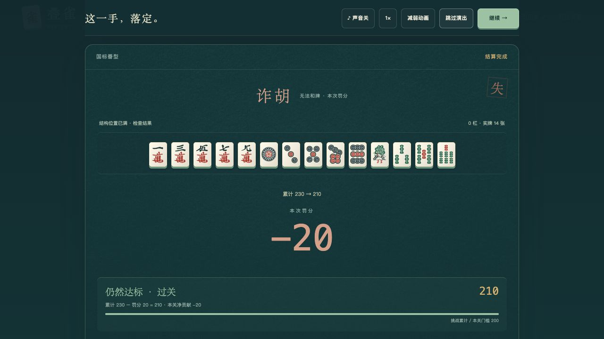

# V5 Review 与本机浏览器验收

日期：2026-10-21（北京时间）。结论：**本轮实现与计分核对通过，可以试玩；不等于四路线已达到成熟数值平衡。** 本机桌面浏览器实际操作、固定牌形核算、8000局模拟分别记录，不混为真人胜率。

## 版本范围与 Review

基线为 `aed7c7b`，规则以 [V5_BALANCE_REPORT.md](V5_BALANCE_REPORT.md) 和 `dist/balance.js` 为准。已落地开局5次、每次最多5张弃换；普通改牌只限准备阶段；大番补缺例外；固定四选一核心；4总槽、1核心；每关一件奖励；四条计分路径与累计门槛；V4结算动效；对应V5匿名统计。

实施前的范围检查与实施后的规格、代码检查均已完成。未增加关外养成、新货币、额外商店、可递归复制机制或新的自动化测试脚本。保留现有P0测试文件与本机验收入口。

| Review 发现 | 处理与复核 |
| --- | --- |
| 历史计划中6槽、核心可换等口径与本版冲突 | README和三份历史计划标注本版覆盖关系，核心固定、4槽作为当前规则 |
| 奖励可能出现当前路线不可用的核心配件 | 过滤非大番的补缺符、非留牌的余音扇及已停用遗物 |
| `111222333` 的联动提示把同一实体牌计入多种拆分 | 使用共享且不重复用牌的面子拆分，复核为3组 |
| 动效资源若长时间等待可能挡住继续 | 加8秒总等待上限和冻结结果兜底；迟到加载不能回填或改分 |
| 留牌复触可能错误进入下一倍率档 | 档位绑定原实体牌序号，重触发沿用原档；显示爆发档 |

最终复核未发现未解决的P0/P1或计划内功能遗漏。计分只由引擎提交一次，动效、跳过、重播只读取已保存结果；这不包含“数值已经充分平衡”的承诺。

## 环境与证据范围

- 本机 macOS、Codex 内嵌桌面浏览器，通过可见按钮逐步操作。
- `127.0.0.1:4180` 为当前源文件的本机QA服务，`/__qa` 指向已有 `tests/browser-harness.html`；入口不打包上线。
- 固定种子新局只指定RNG种子，其余为正常发牌、换牌与出牌。定牌场景会明确设置牌形、配件和成长值，仅用于功能验证。
- `127.0.0.1:4175` 是 `npm run dev` 的正式构建与本地Worker/D1预览。另验证四核心选择页及统计请求。
- 未做物理手机、跨浏览器或音效听感验收。演出静音、跳过、2倍速、减弱动画入口可用；截图不证明音频听感。

## 正常随机试玩：四路线各一局

四局均为国标、初始只有所选核心，没有注入配件或预设牌形。全部失败样本保留，不反复刷到胜利后替换记录。

| 路线 | 种子 | 5次实际弃换张数 | 累计摸到实体牌 | 首关和牌分 | 罚分后累计 | 结果 |
| --- | --- | --- | --- | --- | --- | --- |
| 大番 | 2026102101 | 4、4、2、1、1 | 38/136 | 0 | −20 | 诈胡失败 |
| 刻子 | 2026102102 | 5、1、1、1、1 | 35/136 | 0 | −20 | 诈胡失败 |
| 留牌 | 2026102103 | 5、3、3、2、2 | 41/136 | 0 | −20 | 诈胡失败 |
| 成长 | 2026102104 | 5、5、2、2、2 | 42/136 | 0 | −20 | 诈胡失败，成长不增加 |

最终成型牌（`m/p/s` 分别为万/筒/索）：

- 大番：`234567m 33567p 457s`，索子缺搭。
- 刻子：`444567m 67p 336889s`，两个搭子未完成。
- 留牌：`12345677m 24p 5789s`，没有完整四面子。
- 成长：`22467m 357789p 456s`，两组搭子未完成。

这些局由操作者依据当前可见牌决策，策略不保证最优。样本只有每路线1局，不能估计路线胜率、平均分，也不能证明它们相等。它们实际确认了：常规组牌不再遍历全牌库，普通换牌不会在组牌中继续开放，未和牌不会发放核心收益，诈胡会结束本关。

8000局有限可见牌策略的首关合法率约39.2%–39.6%，总体最终净分中位数均−20。上述4局失败与“首关成型风险高”的方向一致，但样本不足以检验模拟校准准确性。**本版最需要真人反馈的是成型难度；降低分数门槛本身无法修复无效牌形。**

## 定牌计分：两模式 × 四路线

下表均在正式游戏界面查看预览后按“和牌并结算”，再核对演出最终数值；八项误差均为0。它们是不同条件的功能样本，不能横向当作四路线的期望收益。均在第1关，因此不含末关×0.8。

| 路线/定牌条件 | 国标预览 | 国标演出 | 日麻预览 | 日麻演出 |
| --- | ---: | ---: | ---: | ---: |
| 九莲宝灯，核心＋补缺符＋温玉＋回响铃 | 983,040 | 983,040 | 983,040 | 983,040 |
| 四刻，核心＋复鸣铃＋刻石＋温玉 | 9,237,258 | 9,237,258 | 9,237,258 | 9,237,258 |
| 三顺一刻，留12张幺九，核心＋余音扇＋温玉＋回响铃 | 1,651,921 | 1,651,921 | 2,936,749 | 2,936,749 |
| 三顺一刻，成长核心＋复鸣铃＋温玉＋流云梳 | 8,421 | 8,421 | 14,972 | 14,972 |

可直接复核的公式：

- 九莲：`floor(320 × 2048 × 1.5) = 983040`，不是没有奇物的原始牌型倍率。
- 四刻：8次刻子事件，`floor(815 × 3 × 2.8^8) = 9237258`。国标16番、日麻2翻在普通倍率中恰好都是3。
- 留牌：前9张各触发2次×1.22，末3张各触发2次×2；`floor(320 × 普通倍率 × 1.22^18 × 2^6)`。国标10番倍率2.25，日麻3翻倍率4。复触没有提前进入爆发档。
- 成长场景人为预置了12次既往成长事件，本手3顺×2得到6次新增事件；总18次后取整贡献3375底分，最终底分3743。国标倍率2.25、日麻倍率4。它不是新开局自然获得3375成长的证据。

与数值报告的理论表比较时必须保持牌形、配件、成长事件数与关卡相同。报告中的六关满成长、末关倍率与这里第1关的定牌场景不同，不能直接比较总数。

其他证据：[四刻](screenshots/v5-pung-settlement.png)、[留牌](screenshots/v5-held-settlement.png)、[成长](screenshots/v5-growth-settlement.png)、[四核心选择](screenshots/v5-four-cores.png)。

## P0 流程验收

| 实际操作 | 结果 |
| --- | --- |
| 四核心开局 | 四项均显示原画和当前说明；总4格、1核心，开始前可选 |
| 准备阶段普通改牌 | 一万＋1成为二万、三万改索、四万化花色万能；墨4→0，万能机会消耗 |
| 点击开始组牌 | 普通弃换、改牌入口关闭；成型区不可替换，花色万能身份保留 |
| 大番补缺 | 在持有核心和补缺符的定牌场景里改点完成缺口，消耗1墨；换牌/改牌共享一次，用后关闭。此流程预验发生在最终倍率冻结前，不将当时分数纳入最终数值表 |
| 四张同牌声明杠 | 8结构＋4张一万成为11结构/12实体；再放456万成为14结构/15实体，合法结算1216，演出标注杠 |
| 诈胡但累计够分 | 230−20=210，仍超过200，进入正常关后奖励；无和牌分 |
| 诈胡未够分 | 四局正常随机试玩均为0−20=−20，结束挑战 |
| 满4槽换奖励 | 预验仅列非核心可替换对象，替换后仍4件；不能购入额外奖励 |
| 跳过奖励 | 保留4件、累计210，进入下一关准备，显示下一累计门槛500 |
| 成长结算后刷新/重播 | 恢复页写明累计0→8421；重播后仍8421，没有重复成长或加分 |
| 演出加速/减弱/跳过 | 日麻九莲仍983040；继续可用，数据保持冻结 |
| 本地构建与统计 | 首页及四核心页正常；本地注册201、事件上报200；既有关闭偏好仍被保留，手动开启后正常发送 |

QA与最终构建浏览器控制台检查未见error/warn。未主动模拟断网与各种GPU环境；加载超时由既有P0测试覆盖，不冒充真实弱网验收。

## 数值是否达到预期

8000局最终确认集的通关率如下，每格1000局，置信区间、全体均分、条件均分、构筑成型率及复现源码见数值报告及JSON。

| 路线 | 国标通关率 | 日麻通关率 | 当前判断 |
| --- | ---: | ---: | --- |
| 大番 | 10.0% | 8.9% | 稀有牌有高上限；普通牌收益和专用补缺可运作 |
| 刻子 | 9.0% | 7.8% | 成型偏难；极端四刻复触仍使均值明显偏高 |
| 留牌 | 14.2% | 10.0% | 常规收益相对平稳，10～12张的爆发条件稀少 |
| 成长 | 14.5% | 12.5% | 生存后有后劲，必须把首关失败纳入期望 |

**功能结果与冻结公式一致；真人平衡是否匹配模拟尚不能确认。** 四路线都有大数字路径，但刻子均值仍由极少数千万级样本主导，首关对四路线都偏苛刻。保留本版作为可试玩规则，不用上限样本或仅成功玩家均分掩盖问题，也不在验收末尾继续增加机制或无数据重调参数。

## 构建检查

- `npm test`：130通过、0失败（引擎26、结算适配10、统计94）。
- `npm run build`：成功，保留游戏与V4演出资源。
- 最终代码Review复核通过；本文件与截图随版本一同保存。
- 仅本地预览；Git同步由「整理代码并准备纯净版」会话负责，未执行公网部署。
